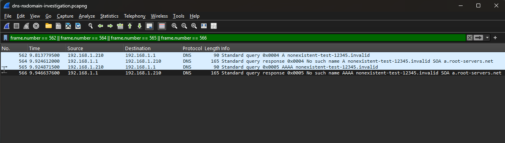

# DNS Traffic Analysis & Threat Investigation

## 1. Investigation Overview

This investigation examines Domain Name System (DNS) traffic captured using Wireshark to understand how domain names are resolved into IP addresses and how DNS responses can be analyzed during security investigations.

The analysis focuses on identifying DNS queries and responses, examining common DNS record types, and investigating unsuccessful domain resolution attempts.

Particular attention is given to:

- **A Records:** DNS records that map domain names to IPv4 addresses.
- **AAAA Records:** DNS records that map domain names to IPv6 addresses.
- **CNAME Records:** DNS records that identify aliases pointing to canonical domain names.
- **NXDOMAIN Responses:** DNS responses indicating that the queried domain name does not exist.

The investigation also explores how SOC analysts can use DNS traffic to identify potentially suspicious activity, such as repeated failed domain lookups, unusual domain names, and possible indicators of malicious infrastructure.

**Investigation Scope:** Analysis of DNS traffic contained in `dns-nxdomain-investigation.pcapng` using Wireshark.

**Investigation Objective:** Develop practical DNS analysis skills applicable to network monitoring, threat detection, and SOC investigations.

## 2. Investigation Objectives

The primary objective of this investigation is to analyze DNS traffic using Wireshark and develop practical network security investigation skills.

The investigation aims to:

1. **Identify DNS Queries and Responses:** Examine DNS request and response packets to understand how DNS resolution occurs.

2. **Analyze DNS Record Types:** Identify A, AAAA, and CNAME records and explain their roles in domain name resolution.

3. **Investigate NXDOMAIN Responses:** Examine DNS responses indicating that a requested domain name does not exist.

4. **Analyze DNS Transaction Details:** Identify DNS transaction IDs, source and destination IP addresses, UDP ports, and response codes to correlate DNS queries with their corresponding responses.

5. **Identify Potential Security Indicators:** Evaluate whether unusual DNS queries, repeated failed lookups, or suspicious domain patterns could indicate malicious activity.

6. **Document Investigation Findings:** Record packet-level observations and supporting evidence in a structured investigation report suitable for SOC analysis and professional portfolio documentation.

**Expected Outcome:** Demonstrate the ability to interpret DNS traffic, correlate DNS queries and responses, and distinguish normal DNS behavior from activity that may warrant further security investigation.

## 3. Lab Environment

The DNS traffic investigation was conducted in a Windows-based lab environment using Wireshark for packet capture and network traffic analysis.

### 3.1 Tools and Technologies

| Component | Description |
|---|---|
| Operating System | Windows |
| Network Analysis Tool | Wireshark |
| Protocol Analyzed | Domain Name System (DNS) |
| Transport Protocol | UDP |
| DNS Service Port | 53 |
| Packet Capture File | `dns-nxdomain-investigation.pcapng` |
| Investigation Type | DNS Traffic Analysis and Threat Investigation |

### 3.2 Evidence Collection

The investigation uses DNS traffic recorded in the packet capture file `dns-nxdomain-investigation.pcapng`.

The capture is stored in the following project directory:

`captures/dns-nxdomain-investigation.pcapng`

Wireshark was used to examine DNS queries, responses, record types, transaction IDs, and response codes.

### 3.3 Investigation Scope

The investigation focuses on:

- DNS A, AAAA, and CNAME records.
- DNS queries and their corresponding responses.
- NXDOMAIN responses.
- DNS transaction IDs and UDP source/destination ports.
- DNS activity that may warrant further security investigation.

The investigation is limited to the traffic visible in the saved packet capture. Conclusions will be based on observed packet evidence rather than assumptions about malicious activity.

## 4. Investigation Methodology

The DNS traffic investigation was conducted using Wireshark to examine DNS queries, responses, and potential indicators of suspicious network activity.

### 4.1 Packet Capture Examination

The packet capture file `dns-nxdomain-investigation.pcapng` was opened in Wireshark to examine recorded network traffic.

The following Wireshark display filter was used to isolate DNS traffic:

```text
dns
```

This filter displays packets recognized by Wireshark as DNS traffic, allowing the investigator to focus on DNS requests and responses.

### 4.2 DNS Query and Response Analysis

DNS packets were examined to identify:

- Source and destination IP addresses.
- UDP source and destination ports.
- DNS transaction IDs.
- Queried domain names.
- DNS record types, including A, AAAA, and CNAME.
- DNS response codes.

DNS transaction IDs and packet details were used to correlate queries with their corresponding responses.

### 4.3 NXDOMAIN Investigation

The investigation included examining a DNS lookup for the following intentionally nonexistent domain:

`nonexistent-test-12345.invalid`

The purpose of this test was to observe how DNS servers respond when a requested domain name does not exist.

The NXDOMAIN response code was examined to understand how unsuccessful DNS resolution attempts appear in Wireshark.

### 4.4 Security Analysis

DNS traffic was evaluated for characteristics that could warrant additional investigation, including unusual domain names and failed resolution attempts.

An NXDOMAIN response was treated as an unsuccessful DNS lookup rather than automatic evidence of malicious activity.

The investigation findings were documented based on observable packet evidence.

## 5. DNS Packet Analysis

### 5.1 DNS A Record Query — Packet 562

The client workstation (`192.168.1.210`) transmitted a DNS query to the DNS server (`192.168.1.1`) requesting the IPv4 address associated with the domain `nonexistent-test-12345.invalid`.

**Observed Packet Details:**

| Field | Value |
|---|---|
| Packet Number | 562 |
| Source IP | 192.168.1.210 |
| Destination IP | 192.168.1.1 |
| Protocol | DNS |
| DNS Transaction ID | 0x0004 |
| Query Name | nonexistent-test-12345.invalid |
| Query Type | A (IPv4 Address) |
| Packet Length | 90 bytes |

**Analysis:**

The workstation initiated a DNS lookup to determine whether an IPv4 address was associated with the requested domain.

The DNS A record query requests an IPv4 address rather than an IPv6 address.

The transaction ID (`0x0004`) allows the query to be correlated with its corresponding DNS response.

In this capture, Packet 564 contains the matching DNS response.

The queried domain was intentionally nonexistent, allowing the investigator to observe unsuccessful DNS resolution behavior.

### 5.2 DNS NXDOMAIN Response — Packet 564

The DNS server (`192.168.1.1`) responded to the client workstation (`192.168.1.210`) following its request to resolve the domain `nonexistent-test-12345.invalid`.

The response indicated that the requested domain name did not exist.

**Observed Packet Details:**

| Field | Value |
|---|---|
| Packet Number | 564 |
| Source IP | 192.168.1.1 |
| Destination IP | 192.168.1.210 |
| Protocol | DNS |
| DNS Transaction ID | 0x0004 |
| DNS Flags | 0x8183 |
| Message Type | Response |
| Query Type | A (IPv4 Address) |
| Response Code | NXDOMAIN — No such name (3) |
| Authoritative Answer | No |
| Recursion Desired | Yes |
| Recursion Available | Yes |
| Packet Length | 165 bytes |

**Analysis:**

Packet 564 represents the DNS server's response to the client's original A record query in Packet 562.

Both packets share the transaction ID `0x0004`, allowing the request and response to be correlated.

The DNS response contains the reply code `3`, indicating NXDOMAIN (Non-Existent Domain).

The response also indicates that recursion was requested and available, while the responding server was not authoritative for the queried domain.

**Security Interpretation:**

NXDOMAIN responses can occur during normal network activity when applications or users request domain names that do not exist.

However, repeated NXDOMAIN responses involving unusual or randomly generated domain names may warrant further investigation, particularly when examining possible domain generation algorithm (DGA) activity.

In this investigation, the NXDOMAIN response was expected because the queried domain was intentionally nonexistent.

**Finding:** Packet 564 confirms an unsuccessful DNS A record lookup. No malicious activity can be established from this response alone.

### 5.3 DNS AAAA Record Query — Packet 565

The client workstation (`192.168.1.210`) transmitted a DNS AAAA record query to the DNS server (`192.168.1.1`) requesting the IPv6 address associated with `nonexistent-test-12345.invalid`.

**Observed Packet Details:**

| Field | Value |
|---|---|
| Packet Number | 565 |
| Source IP | 192.168.1.210 |
| Destination IP | 192.168.1.1 |
| Protocol | DNS |
| DNS Transaction ID | 0x0005 |
| DNS Flags | 0x0100 |
| Query Name | nonexistent-test-12345.invalid |
| Query Type | AAAA (IPv6 Address) |
| Query Class | IN (Internet) |
| Questions | 1 |
| Answer Records | 0 |
| Corresponding Response | Packet 566 |
| Packet Length | 90 bytes |

**Analysis:**

Packet 565 represents a DNS AAAA record query initiated by the client workstation.

The purpose of the query was to determine whether an IPv6 address existed for the requested domain.

The transaction ID `0x0005` identifies this DNS exchange and allows the query to be correlated with its corresponding response.

The DNS flags `0x0100` indicate a standard query with recursion desired.

The query contained one question and zero answer records, which is expected because the workstation was requesting DNS information.

Wireshark identified Packet 566 as the corresponding DNS response.

**Security Interpretation:**

DNS AAAA queries are commonly generated by systems and applications that support IPv6 connectivity.

The presence of an AAAA query does not indicate malicious activity.

However, examining both A and AAAA queries can help SOC analysts understand a workstation's domain resolution behavior and identify potentially suspicious DNS activity.

**Finding:** Packet 565 confirms that the workstation attempted IPv6 resolution for the intentionally nonexistent domain.

### 5.4 DNS AAAA NXDOMAIN Response — Packet 566

The DNS server (`192.168.1.1`) responded to the client workstation (`192.168.1.210`) following its request to resolve the IPv6 address associated with `nonexistent-test-12345.invalid`.

The response indicated that the requested domain name did not exist.

**Observed Packet Details:**

| Field | Value |
|---|---|
| Packet Number | 566 |
| Source IP | 192.168.1.1 |
| Destination IP | 192.168.1.210 |
| Protocol | DNS |
| DNS Transaction ID | 0x0005 |
| DNS Flags | 0x8183 |
| Message Type | Response |
| Query Type | AAAA (IPv6 Address) |
| Response Code | NXDOMAIN — No such name (3) |
| Authoritative Answer | No |
| Recursion Desired | Yes |
| Recursion Available | Yes |
| Packet Length | 165 bytes |

**Analysis:**

Packet 566 represents the DNS server's response to the client's AAAA record query in Packet 565.

Both packets share the transaction ID `0x0005`, allowing the request and response to be correlated.

The DNS response contains the reply code `3`, indicating NXDOMAIN.

The DNS flags `0x8183` indicate a standard DNS response with recursion desired and recursion available.

The authoritative answer flag was not set, indicating that the responding server was not authoritative for the queried domain.

Unlike a successful AAAA record response, this packet does not provide an IPv6 address for the requested domain.

**Security Interpretation:**

NXDOMAIN responses may occur during normal DNS resolution when applications request nonexistent domain names.

Repeated NXDOMAIN responses involving unusual domain names can warrant further investigation, particularly when examining possible domain generation algorithm (DGA) activity.

However, NXDOMAIN alone does not establish malicious behavior.

In this investigation, the response was expected because the domain was intentionally nonexistent.

**Finding:** Packet 566 confirms that the workstation's AAAA record lookup failed because the requested domain name did not exist.

### 5.5 DNS Query and Response Correlation Summary

| Query Packet | Response Packet | Record Type | Transaction ID | Response |
|---|---|---|---|---|
| 562 | 564 | A (IPv4) | 0x0004 | NXDOMAIN |
| 565 | 566 | AAAA (IPv6) | 0x0005 | NXDOMAIN |

**Overall Finding:**

The packet capture demonstrates two DNS resolution attempts for `nonexistent-test-12345.invalid`.

Both the A and AAAA queries received NXDOMAIN responses.

The matching transaction IDs and reversed source/destination IP addresses support the correlation of each DNS request with its corresponding response.

No malicious activity was established from these DNS exchanges. The observed behavior is consistent with the intentionally generated failed DNS lookup.

## 6. Screenshot Evidence

The following Wireshark screenshot documents the DNS queries and NXDOMAIN responses observed during the investigation.

**Packets Captured:**

- **Packet 562:** DNS A record query for `nonexistent-test-12345.invalid`.
- **Packet 564:** DNS NXDOMAIN response to the A record query.
- **Packet 565:** DNS AAAA record query for `nonexistent-test-12345.invalid`.
- **Packet 566:** DNS NXDOMAIN response to the AAAA record query.



**Evidence Summary:**

The screenshot demonstrates two DNS resolution attempts initiated by the client workstation (`192.168.1.210`) and their corresponding responses from the DNS server (`192.168.1.1`).

Both DNS queries resulted in NXDOMAIN responses, indicating that the requested domain name did not exist.

The matching DNS transaction IDs (`0x0004` and `0x0005`) allow the requests and responses to be correlated.

These findings are consistent with the intentionally generated DNS lookup failures and do not independently indicate malicious activity.