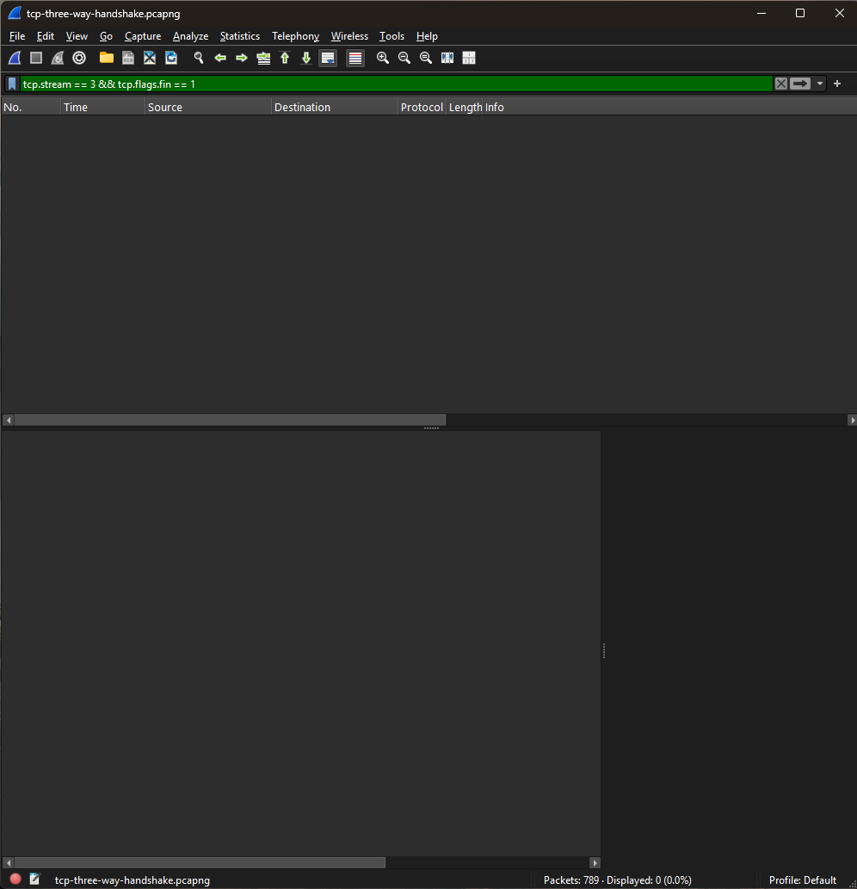
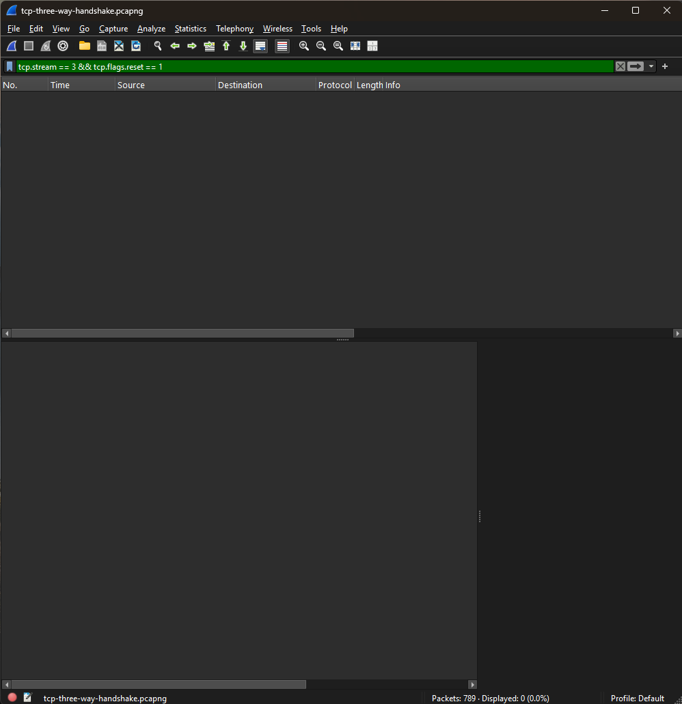
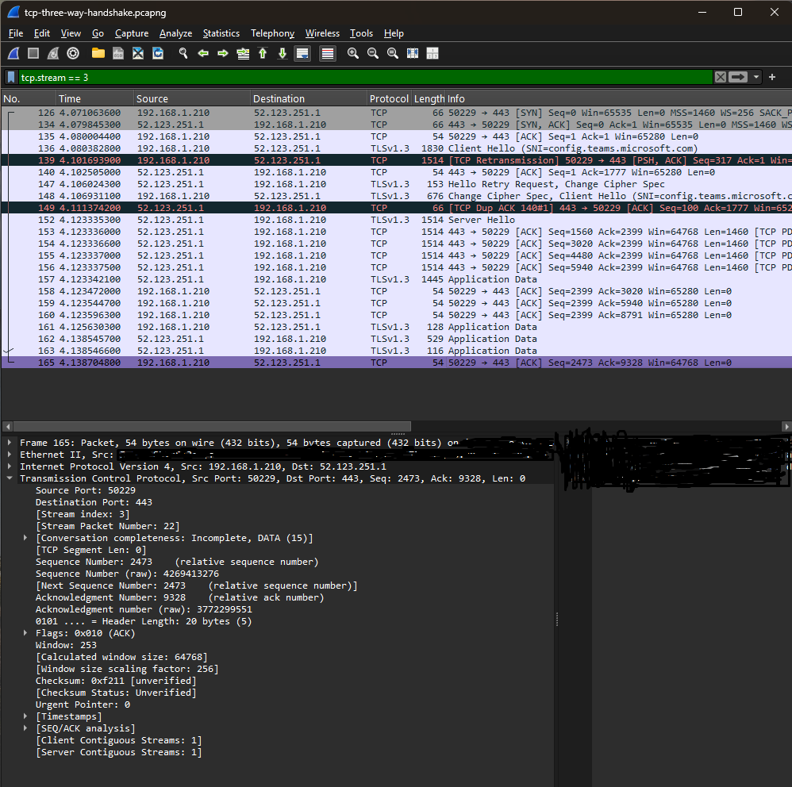
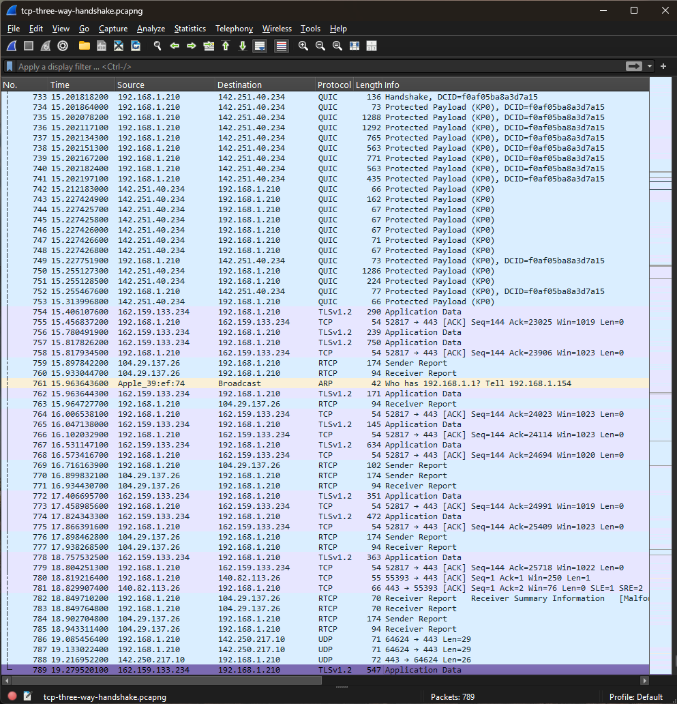

# TCP Connection Termination and Capture Limitations Investigation

## 1. Investigation Overview

This investigation examines TCP connection termination behavior and packet capture visibility limitations using Wireshark.

The analysis focuses on TCP stream 3, representing communication between a local Windows workstation (192.168.1.210:50229) and a remote server (52.123.251.1:443).

Following previous investigations into TCP connection establishment, TLS 1.3 handshake negotiation, TCP retransmission, and Duplicate Selective Acknowledgment (D-SACK), this investigation evaluates whether graceful or abrupt connection termination was observed within the available packet capture.

TCP FIN and RST flags were examined to identify potential connection termination activity. The final observed packet within TCP stream 3 was also compared against the final packet in the overall capture to establish the remaining observation window.

The investigation emphasizes evidence-based analysis, TCP session lifecycle assessment, and the importance of recognizing network monitoring limitations before drawing security conclusions.

## 2. Investigation Objectives

The objectives of this investigation are to:

- Isolate a specific TCP connection using Wireshark stream-based display filters.
- Examine TCP FIN flags to identify evidence of graceful connection termination.
- Examine TCP RST flags to identify evidence of abrupt connection termination.
- Identify and analyze the final observed packet within TCP stream 3.
- Examine TCP sequence numbers, acknowledgment numbers, flags, and conversation completeness.
- Determine the total observed packet capture duration.
- Calculate the remaining observation window following the last observed TCP stream packet.
- Evaluate packet capture limitations and their impact on determining connection state.
- Distinguish confirmed technical findings from assumptions and inconclusive results.
- Document an evidence-based security assessment supported by screenshot evidence.

## 3. Lab Environment

### Tools and Technologies

- Windows operating system
- Wireshark
- Visual Studio Code
- Git and GitHub
- TCP/IP networking
- Transport Layer Security (TLS)

### Packet Capture Details

| Field | Value |
|---|---|
| Capture File | tcp-three-way-handshake.pcapng |
| Total Captured Packets | 789 |
| Observed Capture Duration | 19.279520100 seconds |
| Investigated TCP Stream | 3 |
| Transport Protocol | TCP |
| Application Security Protocol | TLS 1.3 |

### Network Communication Details

| Field | Value |
|---|---|
| Client IP Address | 192.168.1.210 |
| Client Source Port | 50229 |
| Remote Server IP Address | 52.123.251.1 |
| Server Destination Port | 443 |
| Communication Type | HTTPS/TLS |
| TCP Stream Index | 3 |

### Evidence Handling

The investigation was conducted using an existing packet capture previously analyzed during TCP connection establishment, TLS handshake negotiation, and TCP retransmission investigations.

Raw packet capture files are excluded from the public GitHub repository to protect potentially sensitive network information. Screenshot evidence is used to support the documented technical findings.

## 4. Investigation Methodology

The investigation was conducted using a structured network traffic analysis methodology to evaluate TCP connection termination behavior and packet capture limitations.

### 4.1 TCP Stream Isolation

The following Wireshark display filter was applied to isolate the TCP connection of interest:

```wireshark
tcp.stream == 3
```

This filter isolated bidirectional communication between the client and remote server, allowing the connection to be analyzed independently of unrelated network traffic.

### 4.2 Graceful Connection Termination Analysis

The following display filter was applied to identify packets containing the TCP FIN flag:

```wireshark
tcp.stream == 3 && tcp.flags.fin == 1
```

The packet list and displayed packet count were examined to determine whether either endpoint initiated an orderly closure of its sending direction.

### 4.3 Abrupt Connection Termination Analysis

The following display filter was applied to identify packets containing the TCP RST flag:

```wireshark
tcp.stream == 3 && tcp.flags.reset == 1
```

The results were examined to determine whether a TCP connection reset was observed.

### 4.4 Last Observed TCP Stream Packet Analysis

The TCP stream filter was reapplied, and the final displayed packet was examined.

The following fields were analyzed:

- Packet number and timestamp
- Source and destination IP addresses
- Source and destination TCP ports
- TCP stream index
- Relative sequence number
- Relative acknowledgment number
- TCP segment length
- TCP flags
- Conversation completeness

### 4.5 Packet Capture Duration Analysis

The display filter was cleared to restore visibility of all captured packets.

The timestamp of the final captured packet was recorded and compared against the timestamp of the last observed packet within TCP stream 3.

The remaining observation window was calculated using the following formula:

Remaining Observation Window = Final Capture Timestamp - Last TCP Stream Packet Timestamp

### 4.6 Capture Limitations and Security Assessment

The collected evidence was evaluated to determine whether the connection's termination status could be established.

Potential visibility limitations, including capture duration, missed packets, and incomplete network monitoring coverage, were considered.

Confirmed observations were distinguished from possible explanations to prevent unsupported conclusions regarding connection state or malicious activity.

Screenshot evidence was collected to support the investigation findings.

## 5. Packet Analysis

### 5.1 TCP FIN Flag Analysis

The following display filter was applied:

```wireshark
tcp.stream == 3 && tcp.flags.fin == 1
```

| Field | Observed Value |
|---|---|
| TCP Stream | 3 |
| Total Captured Packets | 789 |
| Displayed Packets | 0 |
| FIN Flags Observed | None |
| Graceful Connection Termination | Not Observed |

The TCP FIN flag indicates that an endpoint has finished transmitting data and intends to close its sending direction of the connection.

No packets containing the FIN flag were observed within TCP stream 3.

The absence of FIN packets indicates that graceful connection termination was not observed within the available packet capture. However, this does not establish that graceful termination never occurred.

### 5.2 TCP RST Flag Analysis

The following display filter was applied:

```wireshark
tcp.stream == 3 && tcp.flags.reset == 1
```

| Field | Observed Value |
|---|---|
| TCP Stream | 3 |
| Total Captured Packets | 789 |
| Displayed Packets | 0 |
| RST Flags Observed | None |
| Connection Reset | Not Observed |

The TCP RST flag is used to reject or reset a TCP connection without completing the normal graceful termination process.

No packets containing the RST flag were observed within TCP stream 3.

Therefore, no evidence of an abrupt TCP connection reset was identified within the available capture.

### 5.3 Last Observed TCP Stream Packet

The TCP stream filter was reapplied to identify the final observed packet associated with the investigated connection.

```wireshark
tcp.stream == 3
```

Packet 165 was identified as the final observed packet within TCP stream 3.

| Field | Observed Value |
|---|---|
| Packet Number | 165 |
| Timestamp | 4.138704800 seconds |
| Source IP Address | 192.168.1.210 |
| Destination IP Address | 52.123.251.1 |
| Source Port | 50229 |
| Destination Port | 443 |
| TCP Stream Index | 3 |
| Relative Sequence Number | 2473 |
| Relative Acknowledgment Number | 9328 |
| TCP Segment Length | 0 bytes |
| TCP Flags | 0x010 (ACK) |
| Conversation Completeness | Incomplete, DATA (15) |

Packet 165 was a TCP acknowledgment transmitted from the client to the remote server.

The acknowledgment number of 9328 indicates that the client cumulatively acknowledged server data through relative sequence number 9327 and expected sequence number 9328 next.

The TCP segment contained no payload and did not contain either the FIN or RST flag.

Wireshark also classified the TCP conversation as incomplete. This classification supports the observation that a complete TCP connection lifecycle was not captured.

Packet 165 represents the final observed activity within TCP stream 3, rather than a confirmed connection termination event.

### 5.4 Final Captured Packet Analysis

The display filter was cleared to examine the final packet within the overall capture.

| Field | Observed Value |
|---|---|
| Final Captured Packet | 789 |
| Final Capture Timestamp | 19.279520100 seconds |
| Total Captured Packets | 789 |
| Last TCP Stream 3 Packet | 165 |
| Last TCP Stream 3 Timestamp | 4.138704800 seconds |

Packet 789 established the final observed timestamp of the overall packet capture.

The final captured packet was not associated with TCP stream 3 and therefore could not independently establish the final state of the investigated TCP connection.

### 5.5 Remaining Observation Window

The remaining observation window was calculated by subtracting the timestamp of the last observed TCP stream packet from the timestamp of the final captured packet.

Formula:

Remaining Observation Window = Final Capture Timestamp - Last TCP Stream Packet Timestamp

Calculation:

19.279520100 - 4.138704800 = 15.140815300 seconds

| Measurement | Value |
|---|---|
| Last TCP Stream Activity | 4.138704800 seconds |
| Final Capture Timestamp | 19.279520100 seconds |
| Remaining Observation Window | 15.140815300 seconds |
| Additional TCP Stream 3 Packets Observed | 0 |

Approximately 15.14 seconds of additional capture time elapsed following the last observed packet within TCP stream 3.

No additional packets associated with TCP stream 3 were observed during this period.

This observation does not establish whether the connection remained established, became idle, or terminated without being observed.

### 5.6 Packet Capture Limitations

The absence of TCP FIN and RST packets prevents a definitive determination of the connection's termination status.

Potential explanations include:

- The TCP connection remained established but idle.
- Connection termination occurred after the packet capture ended.
- Connection termination packets were missed or dropped during capture.
- The capture location provided incomplete visibility into the network communication.

These explanations represent possibilities rather than confirmed findings.

Additional evidence, such as an extended packet capture, endpoint connection telemetry, or firewall session logs, would be required to further investigate the connection's final state.

### 5.7 Final Security Assessment

| Investigation Category | Finding |
|---|---|
| TCP Connection Establishment | Successful |
| Graceful Connection Termination | Not Observed |
| Abrupt Connection Reset | Not Observed |
| Last Observed TCP Stream Packet | 165 |
| Remaining Observation Window | 15.140815300 seconds |
| Conversation Completeness | Incomplete |
| Final Connection State | Undetermined |
| Connection Termination Status | Inconclusive |
| Direct Evidence of Malicious Termination | None Observed |

The investigated TCP connection successfully established communication between the local workstation and the remote server.

However, neither graceful connection termination through TCP FIN flags nor abrupt connection termination through TCP RST flags was observed.

The connection's final state could not be determined from the available packet capture.

No direct evidence of malicious connection termination was identified. However, the absence of such evidence does not independently establish that the entire connection was benign.

### 5.8 SOC Analyst Relevance

This investigation demonstrates several skills applicable to Security Operations Center (SOC) investigations:

- TCP session lifecycle analysis
- Network traffic isolation using Wireshark display filters
- TCP flag and header analysis
- Network event timeline reconstruction
- Packet capture visibility assessment
- Evidence-based security analysis
- Identification of investigative limitations
- Technical documentation and reporting

The investigation highlights the importance of distinguishing observable network behavior from assumptions and avoiding unsupported conclusions when available telemetry is insufficient.

## 6. Screenshot Evidence

The following screenshots provide visual evidence supporting the technical findings and conclusions documented throughout this investigation.

### 6.1 TCP FIN Flag Analysis



**Evidence Description:**

The Wireshark display filter isolates packets within TCP stream 3 containing the FIN flag.

The empty packet list and displayed packet count of zero confirm that no TCP FIN packets were observed within the investigated connection.

This demonstrates that graceful connection termination was not observed within the available packet capture.

### 6.2 TCP RST Flag Analysis



**Evidence Description:**

The Wireshark display filter isolates packets within TCP stream 3 containing the RST flag.

The empty packet list and displayed packet count of zero confirm that no TCP RST packets were observed within the investigated connection.

This demonstrates that an abrupt TCP connection reset was not observed within the available packet capture.

### 6.3 Last Observed TCP Stream Packet



**Evidence Description:**

Packet 165 represents the final observed packet within TCP stream 3 at a timestamp of 4.138704800 seconds.

The expanded TCP header displays the source and destination ports, relative sequence number, relative acknowledgment number, TCP segment length, ACK flag, and incomplete conversation classification.

The packet represents an acknowledgment rather than a confirmed connection termination event.

### 6.4 Final Captured Packet



**Evidence Description:**

Packet 789 represents the final recorded packet within the overall packet capture at a timestamp of 19.279520100 seconds.

Comparison with the last observed TCP stream packet establishes a remaining observation window of 15.140815300 seconds.

No additional packets associated with TCP stream 3 were observed during this period.

### 6.5 Evidence Summary

| Screenshot | Supporting Evidence |
|---|---|
| tcp-fin-analysis.png | Absence of observed TCP FIN packets |
| tcp-rst-analysis.png | Absence of observed TCP RST packets |
| tcp-last-stream-packet.png | Final observed TCP stream activity and header analysis |
| tcp-final-capture-packet.png | Final capture timestamp and observation window calculation |

The collected screenshot evidence supports the conclusion that TCP connection termination was not observed and that the connection's final state remains inconclusive due to limited capture visibility.

