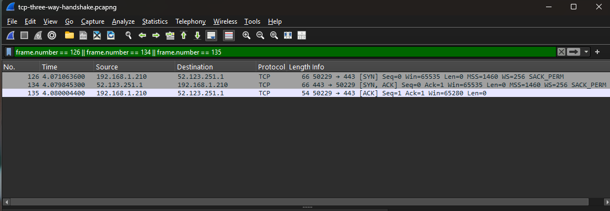

# TCP Three-Way Handshake Analysis

## 1. Investigation Overview

This investigation examines the TCP three-way handshake using Wireshark to understand how a reliable connection is established between a client workstation and a remote server.

The analysis focuses on identifying the SYN, SYN-ACK, and ACK packets, examining TCP sequence and acknowledgment numbers, and understanding how TCP establishes communication before application-layer data is exchanged.

## 2. Investigation Objectives

- Identify the three packets involved in the TCP three-way handshake.
- Examine TCP flags, sequence numbers, and acknowledgment numbers.
- Identify the client and server IP addresses and TCP ports.
- Understand how TCP establishes a reliable, connection-oriented session.
- Apply packet analysis techniques relevant to Security Operations Center (SOC) investigations.

## 3. Lab Environment

| Component | Description |
|---|---|
| Network Analysis Tool | Wireshark |
| Operating System | Windows |
| Capture File | `tcp-three-way-handshake.pcapng` |
| Client IP Address | `192.168.1.210` |
| Server IP Address | `52.123.251.1` |
| Destination Port | TCP 443 (HTTPS) |
| TCP Stream | 3 |

## 4. Investigation Methodology

The packet capture was opened in Wireshark, and TCP traffic was examined to identify the connection establishment process.

The investigation focused on the TCP three-way handshake and the corresponding sequence and acknowledgment numbers.

The identified handshake packets were:

- **Packet 126:** TCP SYN
- **Packet 134:** TCP SYN-ACK
- **Packet 135:** TCP ACK

These packets will be examined in detail in the following section.

## 5. Packet Analysis

### 5.1 TCP SYN — Packet 126

The TCP connection was initiated by the client workstation (`192.168.1.210`) communicating with the remote server (`52.123.251.1`) over TCP port 443.

**Observed packet details:**

| Field | Value |
|---|---|
| Packet Number | 126 |
| Source IP | 192.168.1.210 |
| Destination IP | 52.123.251.1 |
| Source Port | 50229 |
| Destination Port | 443 |
| TCP Flags | SYN (0x002) |
| Relative Sequence Number | 0 |
| Acknowledgment Number | 0 |
| Next Sequence Number | 1 |
| TCP Payload Length | 0 bytes |

**Analysis:**

The client transmitted a TCP SYN packet to initiate a connection with the remote server. The SYN flag indicates a request to establish a TCP session and synchronize initial sequence numbers.

Wireshark displayed a relative sequence number of 0. Although the TCP payload length was 0 bytes, the SYN flag consumed one sequence number, resulting in a next sequence number of 1.

This packet represents the first stage of the TCP three-way handshake.

### 5.2 TCP SYN-ACK — Packet 134

The remote server (`52.123.251.1`) responded to the client's connection request by transmitting a TCP SYN-ACK packet.

**Observed packet details:**

| Field | Value |
|---|---|
| Packet Number | 134 |
| Source IP | 52.123.251.1 |
| Destination IP | 192.168.1.210 |
| Source Port | 443 |
| Destination Port | 50229 |
| TCP Flags | SYN, ACK (0x012) |
| Relative Sequence Number | 0 |
| Relative Acknowledgment Number | 1 |
| Next Sequence Number | 1 |
| TCP Payload Length | 0 bytes |

**Analysis:**

The server transmitted a SYN-ACK packet in response to the client's initial SYN request.

The SYN flag indicates that the server is synchronizing its initial sequence number, while the ACK flag acknowledges the client's SYN.

The acknowledgment number of 1 confirms that the server acknowledged the client's initial sequence number of 0 plus the one sequence number consumed by the SYN flag.

Although this packet contained no TCP payload, the server's SYN consumed one sequence number, resulting in a next sequence number of 1.

This packet represents the second stage of the TCP three-way handshake.

### 5.3 TCP ACK — Packet 135

The client workstation (`192.168.1.210`) transmitted a TCP ACK packet to the remote server (`52.123.251.1`), completing the TCP three-way handshake.

**Observed packet details:**

| Field | Value |
|---|---|
| Packet Number | 135 |
| Source IP | 192.168.1.210 |
| Destination IP | 52.123.251.1 |
| Source Port | 50229 |
| Destination Port | 443 |
| TCP Flags | ACK (0x010) |
| Relative Sequence Number | 1 |
| Relative Acknowledgment Number | 1 |
| Next Sequence Number | 1 |
| TCP Payload Length | 0 bytes |

**Analysis:**

The client acknowledged the server's SYN-ACK response by transmitting a TCP ACK packet.

The relative sequence number of 1 reflects the sequence number consumed by the client's initial SYN packet.

The acknowledgment number of 1 confirms that the client acknowledged the server's initial SYN.

Because this packet contained no TCP payload and did not include a SYN or FIN flag, the client's next sequence number remained 1.

This packet represents the third and final stage of the TCP three-way handshake, establishing the TCP connection for subsequent communication.

### 5.4 Three-Way Handshake Summary

| Stage | Packet | Direction | TCP Flags | Seq | Ack |
|---|---|---|---|---|---|
| 1 | 126 | Client → Server | SYN | 0 | 0* |
| 2 | 134 | Server → Client | SYN, ACK | 0 | 1 |
| 3 | 135 | Client → Server | ACK | 1 | 1 |

*The acknowledgment field in the initial SYN is not valid because the ACK flag is not set.*

**Finding:** The packet capture demonstrates a complete TCP three-way handshake between the client workstation and the remote server over TCP port 443.

The observed SYN, SYN-ACK, and ACK sequence is consistent with normal TCP connection establishment. No abnormalities were identified in these three handshake packets.

## 6. Screenshot Evidence

The following Wireshark screenshot shows the three packets involved in establishing the TCP connection:

- **Packet 126:** Client SYN
- **Packet 134:** Server SYN-ACK
- **Packet 135:** Client ACK

**Evidence Summary:** The screenshot demonstrates the SYN → SYN-ACK → ACK sequence between the client workstation and remote server, confirming that the TCP three-way handshake was observed in the packet capture.