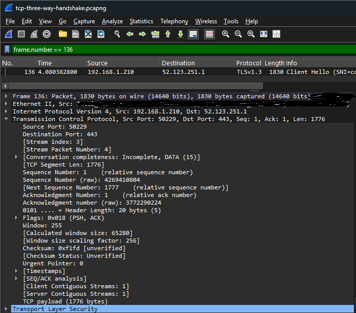
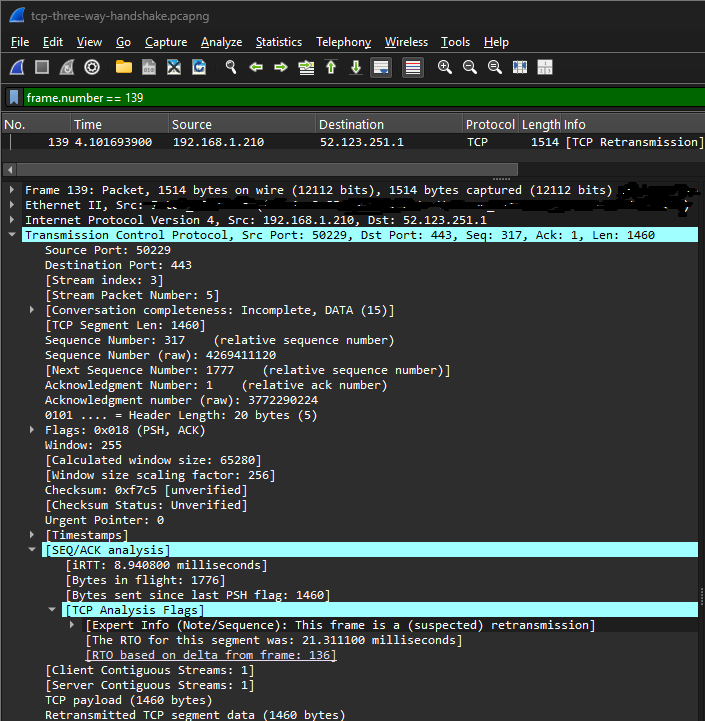
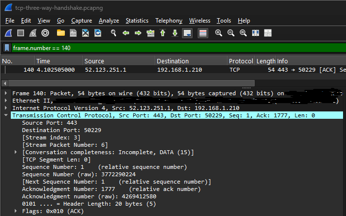
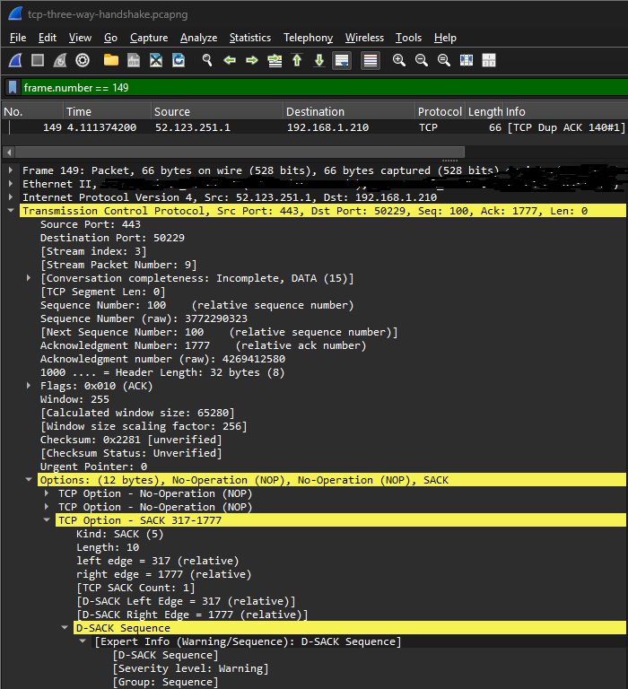

# TCP Retransmission & Duplicate Acknowledgment Investigation

## 1. Investigation Overview

This investigation examines TCP retransmission behavior within captured network traffic using Wireshark. The analysis focuses on identifying retransmitted TCP segments, examining sequence and acknowledgment numbers, and investigating Duplicate Selective Acknowledgment (D-SACK) behavior.

The investigation was conducted within TCP stream 3, involving communication between a client workstation and a remote server over TCP port 443 (HTTPS).

Packet-level evidence was analyzed to identify overlapping TCP sequence-number ranges, verify cumulative acknowledgments, and determine whether the receiving endpoint reported duplicate data.

From a Security Operations Center (SOC) perspective, this investigation demonstrates the importance of distinguishing expected TCP reliability mechanisms from potential network disruptions or suspicious communication patterns.

The investigation also highlights the limitations of packet capture analysis when determining the underlying cause of TCP retransmissions.

## 2. Investigation Objectives

The primary objectives of this investigation were to:

- Identify suspected TCP retransmissions using Wireshark display filters and TCP analysis flags.
- Examine TCP sequence numbers, acknowledgment numbers, and segment lengths.
- Compare original and retransmitted TCP segments to identify overlapping sequence-number ranges.
- Analyze cumulative TCP acknowledgments to verify acknowledged data delivery.
- Investigate Duplicate Selective Acknowledgment (D-SACK) behavior to identify duplicate data received by the remote endpoint.
- Examine Wireshark's retransmission classification and timing information.
- Distinguish expected TCP reliability mechanisms from potentially suspicious network behavior.
- Identify the limitations of packet capture analysis when determining the root cause of retransmissions.
- Document technical findings using packet-level analysis and supporting screenshot evidence.

## 3. Lab Environment

The investigation was conducted using Wireshark on a Windows workstation to analyze previously captured network traffic.

### Tools and Technologies

- Wireshark — Network packet capture and protocol analysis.
- Windows — Host operating system.
- TCP/IP — Network communication and reliable data delivery.
- TLS 1.3 — Encrypted communication protocol.
- Visual Studio Code — Technical documentation.
- Git and GitHub — Version control and project documentation.

### Network Communication Details

| Component | Observed Value |
|---|---|
| Client IP Address | 192.168.1.210 |
| Server IP Address | 52.123.251.1 |
| Client Source Port | 50229 |
| Server Destination Port | 443 (HTTPS) |
| Transport Protocol | TCP |
| TCP Stream | 3 |
| Packet Capture | tcp-three-way-handshake.pcapng |

### Investigation Scope

The investigation focused on four primary packets within TCP stream 3:

- Packet 136 — Original TCP data transmission.
- Packet 139 — Suspected TCP retransmission.
- Packet 140 — Cumulative TCP acknowledgment.
- Packet 149 — Duplicate Selective Acknowledgment (D-SACK).

The original packet capture is retained locally and excluded from the public GitHub repository to protect potentially sensitive network information. Selected screenshots are used to provide supporting packet-level evidence.

## 4. Investigation Methodology

The investigation followed a structured packet analysis methodology using Wireshark.

### 4.1 Traffic Identification and Filtering

The existing packet capture was opened in Wireshark, and TCP stream 3 was isolated using the following display filter:

`tcp.stream == 3`

Individual packets were examined using the following display filters:

- `frame.number == 136` — Original TCP data transmission.
- `frame.number == 139` — Suspected TCP retransmission.
- `frame.number == 140` — Cumulative TCP acknowledgment.
- `frame.number == 149` — Duplicate Selective Acknowledgment (D-SACK).

### 4.2 TCP Sequence Number Analysis

The original and retransmitted TCP segments were compared by examining:

- Relative sequence numbers.
- Relative acknowledgment numbers.
- TCP segment lengths.
- Next sequence numbers.
- TCP flags.

These fields were used to identify overlapping TCP sequence-number ranges and calculate the amount of retransmitted data.

### 4.3 Acknowledgment and D-SACK Analysis

The server's cumulative acknowledgment was examined to determine which bytes had been acknowledged.

The TCP SACK option was then inspected to identify the D-SACK left and right edges and determine whether the receiver reported duplicate data.

### 4.4 Wireshark TCP Analysis

The SEQ/ACK analysis section and TCP Analysis Flags were examined to identify:

- Initial round-trip time (iRTT).
- Bytes in flight.
- Suspected retransmission classification.
- Retransmission timing information.
- Reference to the original transmission.

### 4.5 Security Assessment

The collected packet-level evidence was correlated to evaluate whether the observed retransmission behavior was consistent with TCP reliability mechanisms or indicated a potential security concern.

Investigation findings were based on observable evidence rather than assumptions about packet loss, network conditions, or malicious activity.

The underlying cause of the retransmission could not be conclusively established from the available packet capture.

## 5. Packet Analysis

### 5.1 Original TCP Data Transmission — Packet 136

Packet 136 was identified as the original TCP data transmission associated with the subsequent suspected retransmission in packet 139.

The packet contained a TLS Client Hello message transmitted from the client workstation to the remote server over TCP port 443.

**Observed Packet Details:**

| TCP Field | Observed Value |
|---|---|
| Packet Number | 136 |
| Source IP Address | 192.168.1.210 |
| Destination IP Address | 52.123.251.1 |
| Source Port | 50229 |
| Destination Port | 443 |
| TCP Stream | 3 |
| Relative Sequence Number | 1 |
| Relative Acknowledgment Number | 1 |
| TCP Segment Length | 1776 bytes |
| Next Sequence Number | 1777 |
| TCP Flags | PSH, ACK (0x018) |

**Analysis:**

The original TCP transmission contained 1776 bytes of payload, beginning at relative sequence number 1.

The next expected sequence number was calculated as follows:

1 + 1776 = 1777

Therefore, packet 136 covered relative TCP sequence numbers 1 through 1776.

The PSH and ACK flags were set, indicating that the segment carried data with a valid acknowledgment field and requested prompt delivery of received data to the application.

This packet establishes the original sequence-number range used to identify overlapping data in the subsequent suspected retransmission.

**Security Significance:**

Establishing the original TCP sequence-number range allows analysts to identify repeated data and independently evaluate Wireshark's retransmission classification.

The presence of a retransmission does not independently establish packet loss, malicious activity, or a network security incident.

### 5.2 Suspected TCP Retransmission — Packet 139

Packet 139 was identified by Wireshark as a suspected TCP retransmission within TCP stream 3.

The packet contained 1460 bytes of TCP payload transmitted from the client workstation to the remote server.

**Observed Packet Details:**

| TCP Field | Observed Value |
|---|---|
| Packet Number | 139 |
| Source IP Address | 192.168.1.210 |
| Destination IP Address | 52.123.251.1 |
| Source Port | 50229 |
| Destination Port | 443 |
| TCP Stream | 3 |
| Relative Sequence Number | 317 |
| Relative Acknowledgment Number | 1 |
| TCP Segment Length | 1460 bytes |
| Next Sequence Number | 1777 |
| TCP Flags | PSH, ACK (0x018) |
| Wireshark Classification | Suspected Retransmission |

**Analysis:**

Packet 139 began at relative sequence number 317 and contained 1460 bytes of TCP payload.

The next sequence number was calculated as follows:

317 + 1460 = 1777

Therefore, packet 139 covered relative TCP sequence numbers 317 through 1776.

**Comparison with Original Transmission:**

| Field | Packet 136 | Packet 139 |
|---|---|---|
| Starting Sequence Number | 1 | 317 |
| Ending Sequence Number | 1776 | 1776 |
| TCP Payload Length | 1776 bytes | 1460 bytes |
| Next Sequence Number | 1777 | 1777 |

The comparison identified an overlap of 1460 bytes between the original transmission and the suspected retransmission.

Packet 139 repeated the final 1460 bytes of the sequence-number range observed in packet 136 rather than introducing a new sequence-number range.

This overlap supports Wireshark's suspected retransmission classification.

**Security Significance:**

TCP retransmissions are part of TCP's reliability mechanisms and are not inherently indicative of malicious activity.

Frequent retransmissions may warrant further investigation for network congestion, connectivity problems, packet loss, or service degradation.

However, the sequence-number overlap alone does not establish the underlying cause of the retransmission or confirm that packet loss occurred.

### 5.3 Cumulative TCP Acknowledgment — Packet 140

Packet 140 was identified as a TCP acknowledgment transmitted from the remote server to the client workstation following the suspected retransmission in packet 139.

**Observed Packet Details:**

| TCP Field | Observed Value |
|---|---|
| Packet Number | 140 |
| Source IP Address | 52.123.251.1 |
| Destination IP Address | 192.168.1.210 |
| Source Port | 443 |
| Destination Port | 50229 |
| TCP Stream | 3 |
| Relative Sequence Number | 1 |
| Relative Acknowledgment Number | 1777 |
| TCP Flags | ACK (0x010) |

**Analysis:**

The server returned a cumulative acknowledgment with a relative acknowledgment number of 1777.

This acknowledgment indicated that the receiving endpoint had successfully received all TCP data through relative sequence number 1776 and expected sequence number 1777 next.

The acknowledgment number matched the next sequence number observed in both packet 136 and packet 139.

| Packet Number | Function | Relevant Sequence or ACK Value |
|---|---|---|
| 136 | Original TCP transmission | Next Seq: 1777 |
| 139 | Suspected TCP retransmission | Next Seq: 1777 |
| 140 | Cumulative acknowledgment | ACK: 1777 |

This correlation confirmed that the receiving endpoint acknowledged the complete sequence-number range associated with the original transmission.

However, the cumulative acknowledgment alone does not establish whether the original transmission or the retransmitted data arrived first.

**Security Significance:**

Analyzing cumulative acknowledgments allows security analysts to assess TCP data delivery and identify potential communication disruptions.

The observed acknowledgment was consistent with TCP's reliable data delivery mechanisms.

No direct evidence of malicious activity was identified within this acknowledgment. Additional packet-level evidence was required to determine whether duplicate data reached the receiving endpoint.

### 5.4 Duplicate Selective Acknowledgment (D-SACK) — Packet 149

Packet 149 contained a TCP Duplicate Selective Acknowledgment (D-SACK) transmitted from the remote server to the client workstation.

The TCP options were examined to identify the sequence-number range reported as duplicate data by the receiving endpoint.

**Observed Packet Details:**

| TCP Field | Observed Value |
|---|---|
| Packet Number | 149 |
| Source IP Address | 52.123.251.1 |
| Destination IP Address | 192.168.1.210 |
| Source Port | 443 |
| Destination Port | 50229 |
| TCP Stream | 3 |
| TCP Option | Selective Acknowledgment (SACK) |
| Option Kind | 5 |
| Option Length | 10 bytes |
| SACK Block Count | 1 |
| D-SACK Left Edge | 317 |
| D-SACK Right Edge | 1777 |

**Analysis:**

The D-SACK option reported a duplicate TCP sequence-number range beginning at relative sequence number 317 and ending immediately before sequence number 1777.

The amount of duplicate data was calculated as follows:

1777 - 317 = 1460 bytes

The reported duplicate sequence-number range matched the suspected retransmission observed in packet 139.

| Evidence | Packet 139 | Packet 149 |
|---|---|---|
| Starting Sequence Number | 317 | 317 |
| Ending Boundary (Exclusive) | 1777 | 1777 |
| Data Length | 1460 bytes | 1460 bytes |

This correlation provides evidence that the receiving endpoint received duplicate TCP data corresponding to the sequence-number range observed in the suspected retransmission.

The D-SACK response suggests that the retransmission may have been unnecessary. However, the available packet capture does not conclusively establish the underlying cause.

**Security Significance:**

D-SACK provides additional visibility into TCP reliability and duplicate data delivery.

Security analysts can use D-SACK information to investigate potentially unnecessary retransmissions, network delays, and communication performance issues.

The observed D-SACK behavior was consistent with TCP reliability mechanisms. No direct evidence of malicious activity was identified within the examined packet sequence.

Further investigation would be required to determine the root cause of the retransmission.

### 5.5 TCP Retransmission Classification and Timing Analysis

The SEQ/ACK analysis section of packet 139 was examined to investigate Wireshark's retransmission classification and associated timing information.

**Observed TCP Analysis Details:**

| Analysis Field | Observed Value |
|---|---|
| Packet Number | 139 |
| Initial Round-Trip Time (iRTT) | 8.940800 milliseconds |
| Bytes in Flight | 1776 bytes |
| Bytes Sent Since Last PSH Flag | 1460 bytes |
| Expert Information Severity | Note |
| Expert Information Group | Sequence |
| TCP Analysis Classification | Suspected Retransmission |
| Reported Retransmission Timing (RTO) | 21.311100 milliseconds |
| RTO Reference Frame | 136 |

**Analysis:**

Wireshark classified packet 139 as a suspected TCP retransmission based on its TCP sequence analysis.

The reported retransmission timing of 21.311100 milliseconds was calculated using the elapsed time between packet 136 and packet 139.

This timing represents an observed interval within the packet capture and does not independently establish the sender's configured retransmission timeout.

The initial round-trip time (iRTT) of 8.940800 milliseconds provided additional context regarding the connection's initial communication latency.

The bytes-in-flight value indicated that Wireshark tracked 1776 bytes of outstanding TCP data at the time of its analysis.

**Retransmission Classification:**

Wireshark classified packet 139 as a suspected retransmission rather than explicitly identifying it as a fast retransmission or spurious retransmission.

However, the subsequent D-SACK observed in packet 149 provided evidence that duplicate TCP data reached the receiving endpoint.

This finding suggests that the retransmission may have been unnecessary, although its underlying cause could not be conclusively determined.

**Security Significance:**

TCP analysis flags and timing information provide useful context when investigating network performance issues and communication anomalies.

Security analysts should correlate automated analysis flags with sequence numbers, acknowledgments, timing information, and additional packet-level evidence before reaching conclusions.

The observed retransmission did not independently establish packet loss, network congestion, or malicious activity.

### 5.6 Investigation Findings and Security Assessment

The TCP retransmission investigation identified overlapping TCP sequence-number ranges, cumulative acknowledgment behavior, and duplicate data delivery within TCP stream 3.

**Summary of Findings:**

| Packet | Observation | Investigation Finding |
|---|---|---|
| 136 | Original TCP transmission | Established the original 1776-byte sequence-number range. |
| 139 | Suspected TCP retransmission | Identified 1460 bytes of overlapping TCP data. |
| 140 | Cumulative acknowledgment | Confirmed acknowledgment of data through sequence number 1776. |
| 149 | Duplicate Selective Acknowledgment | Reported 1460 bytes of duplicate TCP data. |

**Confirmed Technical Findings:**

- The original TCP transmission contained 1776 bytes of payload.
- The suspected retransmission covered relative sequence numbers 317 through 1776.
- Approximately 82.2% of the original sequence-number range was repeated.
- The receiving endpoint returned a cumulative acknowledgment of 1777.
- The D-SACK option reported a duplicate sequence-number range matching the suspected retransmission.
- Wireshark classified packet 139 as a suspected TCP retransmission.
- The observed interval between the original transmission and suspected retransmission was approximately 21.31 milliseconds.

**Security Assessment:**

The observed packet sequence was consistent with TCP reliability and duplicate data handling mechanisms.

Although the retransmission may have been unnecessary, no direct evidence of malicious activity was identified within the examined packet sequence.

The available evidence does not justify classifying the observed retransmission as a confirmed security incident.

**Investigation Limitations:**

The packet capture alone could not conclusively establish:

- Whether actual packet loss occurred.
- Whether network congestion contributed to the retransmission.
- Whether delayed acknowledgments triggered the retransmission.
- Whether endpoint TCP behavior contributed to the retransmission.
- Whether network adapter offloading affected the observed segment sizes.
- The definitive root cause of the retransmission.

Additional endpoint telemetry, network performance metrics, and packet captures from multiple network locations would be required to investigate these possibilities.

**Final Conclusion:**

The investigation successfully identified and correlated TCP retransmission behavior using sequence numbers, acknowledgment numbers, TCP analysis flags, timing information, and Duplicate Selective Acknowledgment evidence.

The findings demonstrate the importance of independently validating automated detection classifications and distinguishing confirmed observations from potential explanations.

From a SOC perspective, the examined traffic was consistent with TCP reliability mechanisms, with no direct evidence supporting classification as a security incident.

## 6. Screenshot Evidence

The following screenshots provide supporting packet-level evidence for the TCP retransmission investigation.

### 6.1 Original TCP Data Transmission — Packet 136

**Evidence:** Packet 136 establishes the original TCP sequence-number range, beginning at relative sequence number 1 and containing 1776 bytes of TCP payload.

### 6.2 Suspected TCP Retransmission — Packet 139

**Evidence:** Packet 139 contains 1460 bytes of overlapping TCP data beginning at relative sequence number 317. The expanded SEQ/ACK analysis displays Wireshark's suspected retransmission classification, initial round-trip time, retransmission timing, and reference to packet 136.

### 6.3 Cumulative TCP Acknowledgment — Packet 140

**Evidence:** Packet 140 displays a cumulative acknowledgment of 1777, confirming that the receiving endpoint acknowledged all TCP data through relative sequence number 1776.

### 6.4 Duplicate Selective Acknowledgment — Packet 149

**Evidence:** Packet 149 displays a D-SACK sequence-number range of 317 through 1776, confirming that the receiving endpoint reported 1460 bytes of duplicate TCP data.

### Evidence Handling

The original packet capture is retained locally and excluded from the public repository.

Selected screenshots provide supporting technical evidence while obscuring unnecessary network interface identifiers and MAC addresses and excluding raw packet bytes.