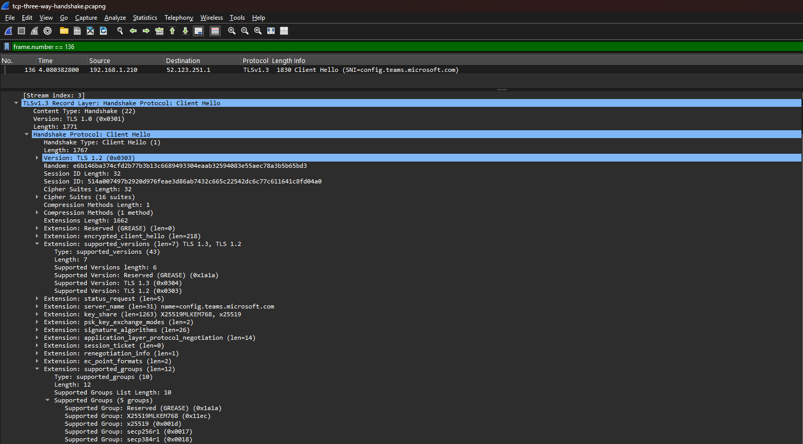
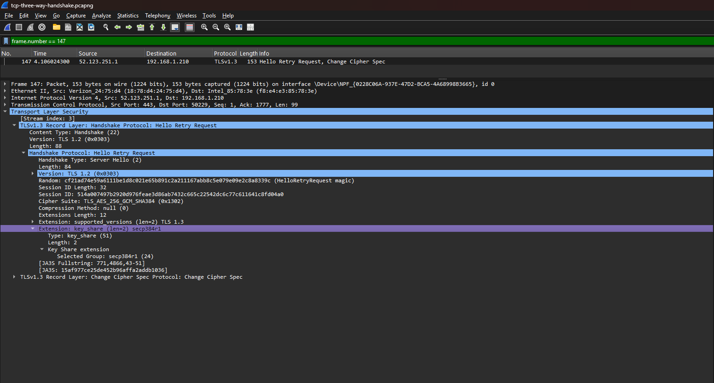
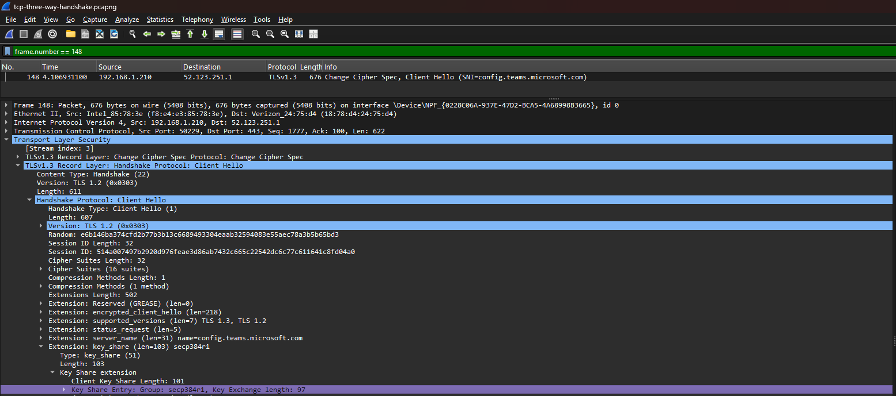
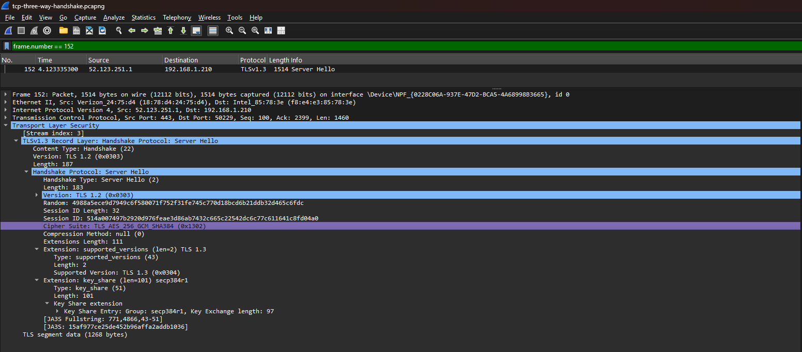

# TLS 1.3 Handshake Investigation

## 1. Investigation Overview

This investigation examines TLS 1.3 handshake negotiation between a client workstation and a remote server communicating over TCP port 443. Using Wireshark, network packets were analyzed to understand how encrypted communication is negotiated, including the exchange of Client Hello and Server Hello messages.

During the investigation, a TLS 1.3 Hello Retry Request was observed, followed by a second Client Hello and a subsequent Server Hello. The analysis focused on identifying the negotiated TLS version, cipher suite, and key exchange group.

The investigation demonstrates how a SOC analyst can examine TLS handshake metadata to understand encrypted network connections without decrypting application traffic.

## 2. Investigation Objectives

The objectives of this investigation were to:

1. Identify TLS handshake messages exchanged between the client workstation and remote server.
2. Analyze the initial Client Hello and determine the TLS versions and key exchange parameters offered by the client.
3. Examine the Hello Retry Request and explain why the server requested another Client Hello.
4. Inspect the second Client Hello to identify the updated key share information.
5. Analyze the Server Hello to determine the negotiated TLS version, cipher suite, and key exchange group.
6. Correlate TLS handshake messages with their corresponding TCP packets using Wireshark.
7. Understand how TLS handshake metadata can support SOC investigations without decrypting application traffic.

## 3. Lab Environment

The TLS 1.3 investigation was conducted using the following environment:

- **Network Analysis Tool:** Wireshark
- **Packet Capture:** `tcp-three-way-handshake.pcapng`
- **Client IP Address:** `192.168.1.210`
- **Remote Server IP Address:** `52.123.251.1`
- **Client TCP Port:** `50229`
- **Server TCP Port:** `443` (HTTPS)
- **TCP Stream:** `3`
- **Protocol Analyzed:** TLS 1.3 over TCP

The packet capture was analyzed locally using Wireshark. TLS handshake messages were examined to identify the negotiation process and understand the cryptographic parameters selected for the connection.

The original packet capture is stored locally and excluded from the public GitHub repository to avoid exposing raw network traffic.

## 4. Investigation Methodology

The TLS 1.3 investigation was performed using Wireshark to examine handshake messages associated with an HTTPS connection.

The following methodology was used:

1. Opened the `tcp-three-way-handshake.pcapng` packet capture in Wireshark.
2. Identified the HTTPS connection between client `192.168.1.210:50229` and remote server `52.123.251.1:443`.
3. Isolated the connection using the Wireshark display filter `tcp.stream == 3`.
4. Examined the TLS Client Hello to identify the initial handshake negotiation.
5. Located the Hello Retry Request in packet 147 and examined the server's requested key exchange group.
6. Inspected the second Client Hello in packet 148 to identify the updated key share information.
7. Examined the subsequent Server Hello in packet 152 to identify the selected TLS version, cipher suite, and key exchange group.
8. Correlated the TLS handshake messages with their corresponding TCP packets and documented the observed negotiation behavior.

The analysis focused on observable TLS handshake metadata. Encrypted application content was not decrypted during this investigation.

## 5. Packet Analysis

### 5.1 Initial TLS Client Hello — Packet 136

The initial TLS Client Hello was identified in packet 136 within TCP stream 3. The client initiated TLS negotiation with the remote server over TCP port 443.

**Observed Packet Details:**

- **Packet Number:** 136
- **Handshake Type:** Client Hello (1)
- **Handshake Length:** 1767 bytes
- **Legacy Version:** TLS 1.2 (0x0303)
- **Supported Versions:** TLS 1.3 and TLS 1.2
- **Cipher Suites Offered:** 16
- **Server Name Indication (SNI):** `config.teams.microsoft.com`
- **Supported Groups:** X25519MLKEM768, x25519, secp256r1, secp384r1, and a GREASE value
- **Initial Key Shares:** X25519MLKEM768 and x25519, plus a GREASE entry

**Analysis:**

The client advertised support for TLS 1.3 through the `supported_versions` extension. Although the legacy Version field displayed TLS 1.2, this field is retained for protocol compatibility and does not establish the negotiated TLS version.

The `supported_groups` extension included `secp384r1`, but the initial `key_share` extension did not contain a corresponding key share for that group.

This distinction became important when the server subsequently issued a Hello Retry Request asking the client to provide a `secp384r1` key share.

The initial Client Hello also advertised X25519MLKEM768, a hybrid post-quantum key exchange group, demonstrating support for modern cryptographic negotiation mechanisms.

### 5.2 TLS Hello Retry Request — Packet 147

The server's Hello Retry Request was identified in packet 147. This message instructed the client to generate and provide a new key share using the `secp384r1` elliptic curve.

**Observed Packet Details:**

- **Packet Number:** 147
- **TLS Message:** Hello Retry Request
- **Extension:** `key_share` (Type 51)
- **Selected Group:** `secp384r1` (24 / `0x0018`)
- **Key Share Extension Length:** 2 bytes

**Analysis:**

The initial Client Hello in packet 136 advertised `secp384r1` in its `supported_groups` extension. However, the client did not include a corresponding `secp384r1` key share in its initial `key_share` extension.

The server responded with a Hello Retry Request specifying `secp384r1` as the selected group. This instructed the client to send another Client Hello containing key exchange material for that group.

This behavior is consistent with legitimate TLS 1.3 handshake negotiation. A Hello Retry Request does not, by itself, indicate malicious activity or a failed connection.

**Security Significance:**

For SOC analysts, examining a Hello Retry Request helps distinguish normal cryptographic negotiation from unusual connection behavior. The surrounding handshake packets should be correlated before drawing conclusions about potential security incidents.

### 5.3 Second TLS Client Hello — Packet 148

Following the server's Hello Retry Request, the client transmitted a second Client Hello in packet 148. This message included the requested `secp384r1` key share, allowing TLS 1.3 negotiation to continue.

**Observed Packet Details:**

- **Packet Number:** 148
- **Handshake Type:** Client Hello (1)
- **Extension:** `key_share` (Type 51)
- **Key Share Group:** `secp384r1`
- **Key Exchange Length:** 97 bytes
- **Client Key Share Length:** 101 bytes
- **Key Share Extension Length:** 103 bytes

**Analysis:**

The initial Client Hello in packet 136 advertised support for `secp384r1` but did not include a corresponding key share.

In packet 147, the server issued a Hello Retry Request specifying `secp384r1` as the required key exchange group.

The second Client Hello in packet 148 contained a `secp384r1` key share with 97 bytes of key exchange material, confirming that the client responded to the server's request.

This sequence demonstrates how TLS 1.3 supports additional negotiation when the client's initial key shares do not include the server's selected group.

**Security Significance:**

By correlating the initial Client Hello, Hello Retry Request, and second Client Hello, a SOC analyst can distinguish expected TLS negotiation behavior from potential handshake failures or abnormal connection activity.

### 5.4 TLS Server Hello — Packet 152

Following the second Client Hello, the server transmitted a Server Hello in packet 152. This message confirmed the TLS version, cipher suite, and key exchange group selected for the connection.

**Observed Packet Details:**

- **Packet Number:** 152
- **Handshake Type:** Server Hello (2)
- **Handshake Length:** 183 bytes
- **Legacy Version:** TLS 1.2 (`0x0303`)
- **Negotiated TLS Version:** TLS 1.3
- **Selected Cipher Suite:** `TLS_AES_256_GCM_SHA384 (0x1302)`
- **Selected Key Exchange Group:** `secp384r1`
- **Compression Method:** null (0)

**Analysis:**

The Server Hello confirmed that TLS 1.3 was selected through the `supported_versions` extension. Although the legacy Version field displayed TLS 1.2 (`0x0303`), this value is retained for compatibility and does not indicate that TLS 1.2 was negotiated.

The selected cipher suite, `TLS_AES_256_GCM_SHA384`, uses AES-256-GCM for authenticated encryption and SHA-384 in the TLS 1.3 key schedule.

The `key_share` extension identified `secp384r1` as the selected elliptic-curve key exchange group, matching the server's earlier Hello Retry Request and the client's updated key share.

This confirmed that the client and server had agreed on the cryptographic parameters needed to continue establishing their encrypted TLS connection. The Server Hello alone does not establish that the entire TLS handshake completed successfully.

**Security Significance:**

Inspecting Server Hello messages allows SOC analysts to identify negotiated TLS versions, cipher suites, and key exchange groups. These details can support investigations into outdated cryptographic configurations, unusual negotiation behavior, and potential connection security issues.

### 5.5 TLS 1.3 Handshake Summary

The packet analysis identified a TLS 1.3 negotiation sequence involving an initial Client Hello, a Hello Retry Request, a second Client Hello, and a Server Hello.

**Observed Handshake Sequence:**

| Packet | TLS Message | Key Finding |
|---|---|---|
| 136 | Initial Client Hello | Client advertised TLS 1.3 support and offered X25519MLKEM768 and x25519 key shares. |
| 147 | Hello Retry Request | Server requested a new key share using `secp384r1`. |
| 148 | Second Client Hello | Client provided the requested `secp384r1` key share. |
| 152 | Server Hello | Server selected TLS 1.3, `TLS_AES_256_GCM_SHA384`, and `secp384r1`. |

**Key Findings:**

1. The client supported TLS 1.3 and advertised several cryptographic groups, including `secp384r1`.
2. The initial Client Hello did not contain a `secp384r1` key share.
3. The server issued a Hello Retry Request requesting that group.
4. The client responded with the requested key exchange material.
5. The Server Hello confirmed the negotiated TLS version, cipher suite, and key exchange group.

**Security Assessment:**

The observed Hello Retry Request sequence is consistent with legitimate TLS 1.3 negotiation. The examined packets did not establish evidence of malicious activity or a cryptographic downgrade.

The Server Hello confirmed the selected negotiation parameters; however, this analysis did not independently verify completion of the entire TLS handshake or decrypt the subsequent application traffic.

This investigation demonstrates how SOC analysts can use Wireshark to correlate TLS handshake messages, interpret cryptographic negotiation, and distinguish expected protocol behavior from potentially suspicious activity.

## 6. Screenshot Evidence

The following Wireshark screenshots provide packet-level evidence supporting the TLS 1.3 handshake investigation.

### 6.1 Initial Client Hello — Packet 136

### 6.2 Hello Retry Request — Packet 147

### 6.3 Second Client Hello — Packet 148

### 6.4 Server Hello — Packet 152

